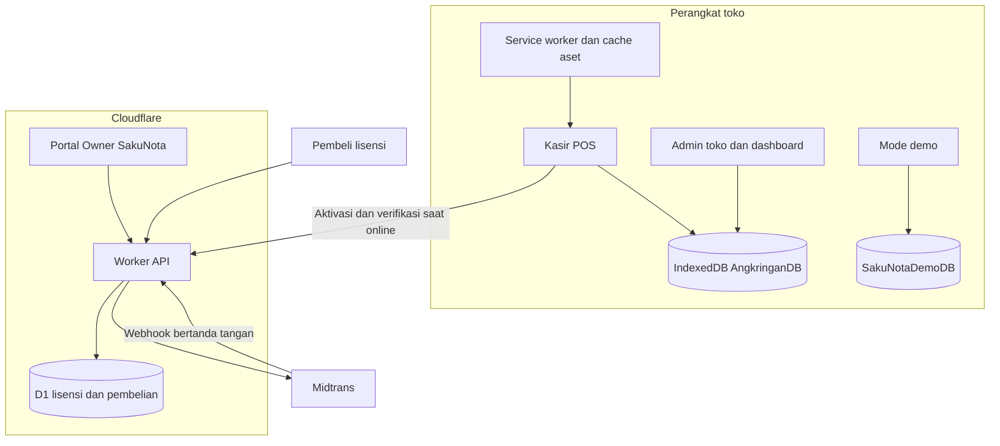
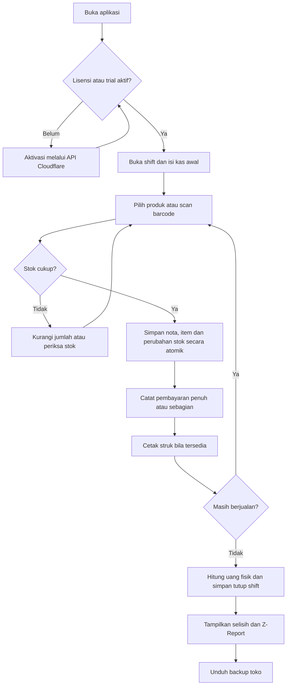
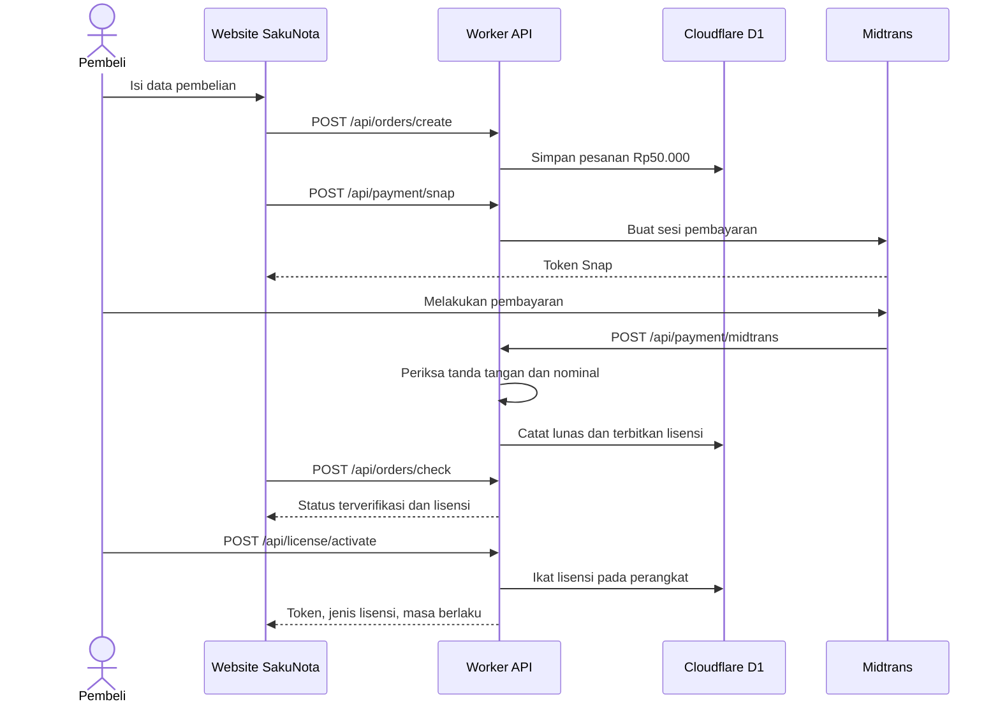
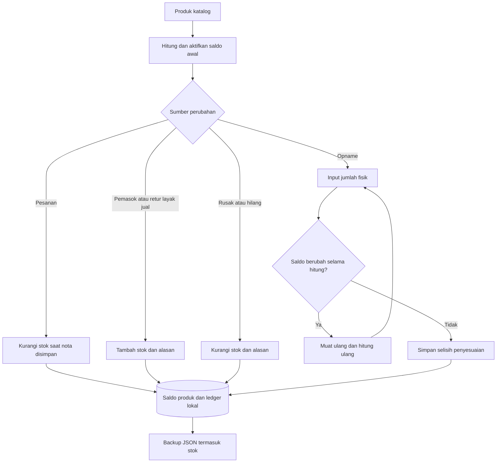

# Arsitektur dan flow SakuNota

## Pemisahan penyimpanan

| Komponen | Lokasi | Isi |
|---|---|---|
| Kasir dan Admin toko | IndexedDB perangkat: `AngkringanDB`, schema 9 | Produk, meja, nota, pembayaran, bukti, shift, kas, stok dan ledger |
| Demo kasir | IndexedDB perangkat: `SakuNotaDemoDB` | Simulasi yang terpisah dari data toko |
| Cache aplikasi | Service worker / CacheStorage | HTML, JavaScript, CSS, font dan ikon; bukan respons API |
| Metadata perangkat | localStorage / sessionStorage | Cache pengaturan, aktivasi dan sesi sesuai fungsi; bukan database transaksi utama |
| Portal Owner SakuNota | Cloudflare Worker + D1 binding `DB` | Pesanan lisensi, lisensi, sesi owner, percobaan login, beta dan tester |
| Midtrans | Layanan pembayaran eksternal | Pembayaran pembelian lisensi SakuNota |

Portal Owner memerlukan internet. Admin toko membaca data lokal, bukan rekap semua pedagang di D1.

## Struktur sistem

## Flow toko harian

## Flow pembelian lisensi

Callback sukses dari popup bukan bukti akhir. Website memeriksa status pesanan server; bila belum terkonfirmasi, tampilkan status menunggu. Transfer manual diverifikasi pengelola melalui portal Owner.

## Flow stok dan opname

Pembayaran lanjutan tidak mengurangi stok kedua kali. Pembatalan nota belum dibayar mengembalikan stok. Refund uang dan retur barang diperlakukan terpisah.

## Endpoint penting

Metode mengikuti kode, bukan daftar lama: pengecekan pesanan mendukung POST; `/api/owner/verify` adalah POST untuk memverifikasi pesanan manual dan menerbitkan lisensi, bukan GET pemeriksaan sesi. Portal memeriksa sesi melalui endpoint Owner yang terautentikasi seperti metrics. `/api/owner/secrets` sekarang hanya mengembalikan status boolean konfigurasi tanpa nilai secret.
